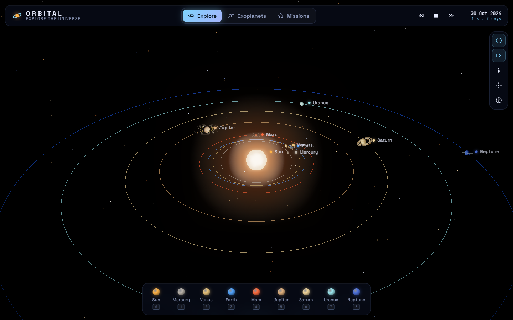
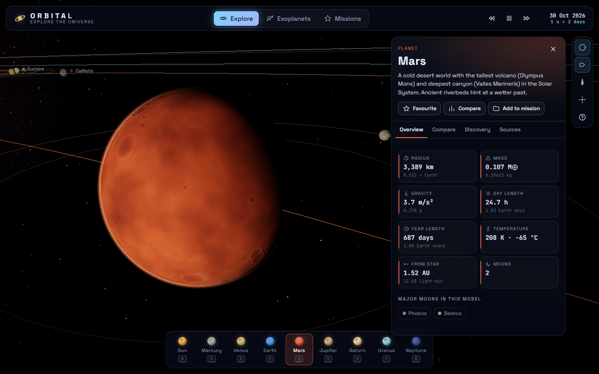
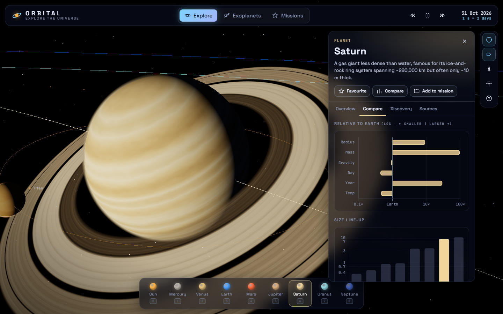
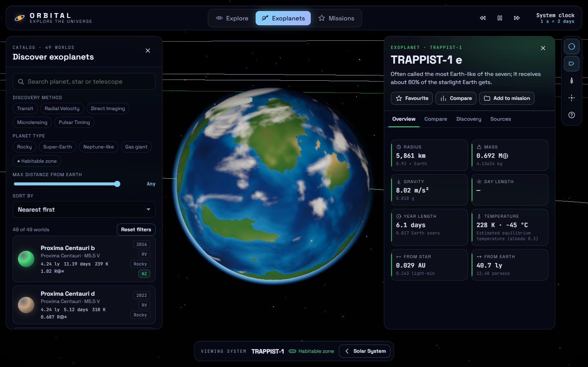
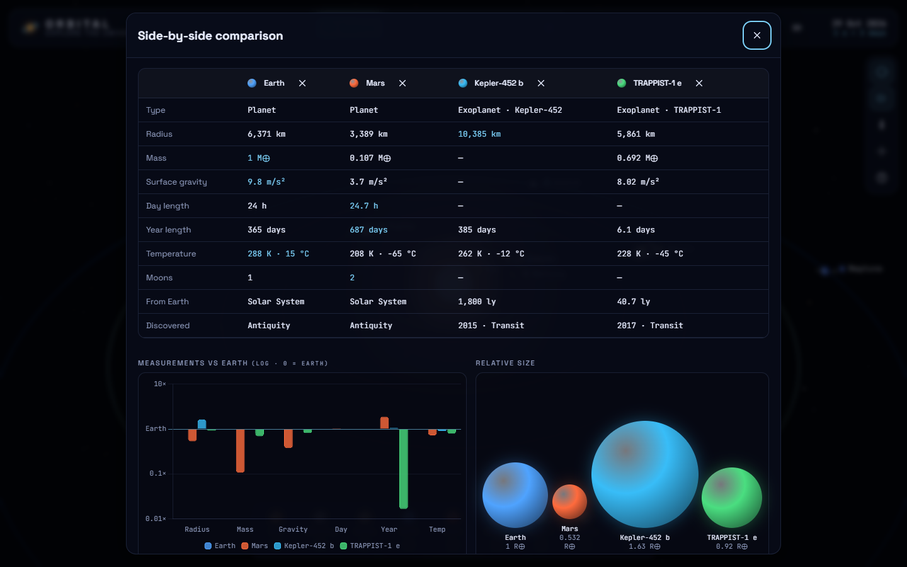
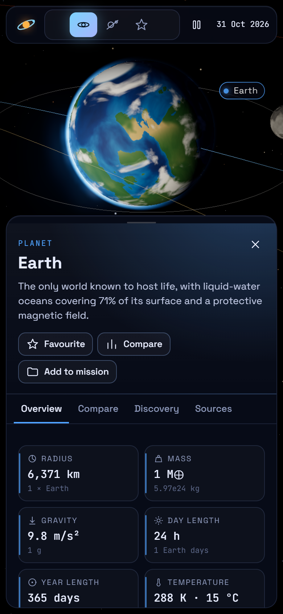

# ORBITAL — Explore the Universe

An interactive 3D explorer for the Solar System and a catalogue of real exoplanets, built with **TypeScript, Three.js and Vite**. Fly between worlds, read their measurements in a HUD-style command panel, compare planets side by side, and save your own exploration missions.

**Live demo → https://hanee2907.github.io/orbital-explore-the-universe/**



## Features

### Explore the Solar System
- The Sun, all eight planets and nine major moons (the Moon, Phobos, Deimos, Io, Europa, Ganymede, Callisto, Titan, Triton), each with a visible orbit path and Saturn's and Uranus' rings.
- **Real positions for today's date.** Each planet's angle is computed from its J2000 mean longitude and mean motion (circular-orbit approximation), so the layout matches the real sky. You can speed time up, slow it down or pause it.
- Orbit, pan and zoom the camera, or click any world (or press `0`–`8`) to fly there along a smooth arc. The camera then follows the body as it orbits.
- **Free-flight mode** (`F`): WASD/arrow keys to move, R/F for up/down, Shift to boost, drag to look. Touch screens get on-screen thrusters.
- Starfield with a Milky Way band, twinkling stars and faint nebulae; an animated Sun shader with HDR bloom; atmospheric limb glow.



### Scientific command panel
- Radius, mass, surface gravity, day and year length, temperature, moons, and distance from the star or parent planet, each shown against Earth.
- **Compare tab:** a diverging log-scale chart (smaller ← Earth → larger) and a size line-up against the eight planets.
- Discovery details (year, discoverer or facility, method) with a short explanation of how that detection method works.
- Links to sources: NASA Science pages, the NASA Planetary Fact Sheets and the NASA Exoplanet Archive.



### Discover exoplanets
- A curated catalogue of **49 well-known exoplanets**, including all seven TRAPPIST-1 worlds, Proxima Centauri b and d, Kepler-452 b, 51 Pegasi b, HD 209458 b, K2-18 b, 55 Cancri e, KELT-9 b, the directly imaged HR 8799 planets and a pulsar planet.
- Filter by discovery method, planet type and maximum distance, or show only habitable-zone worlds. Search by planet, star or telescope, and sort by distance, discovery year, size or temperature.
- **View any system in 3D:** the host star is coloured by its temperature, planets sit at scaled orbital distances, and the habitable zone is drawn as a green band.
- Where a value isn't measured, it is derived and clearly labelled:
  - equilibrium temperature `T = T★ · √(R★ / 2a) · (1 − A)^¼`
  - radius from mass using the Chen & Kipping (2017) mass–radius relation
  - habitable-zone edges from stellar luminosity



### Missions (saved on your device)
- **Favourites:** star any world.
- **Compare tray:** compare 2–4 worlds in a side-by-side table, a grouped chart and a relative-size view. Comparisons can be shared as links, e.g. `#/compare/earth,mars,exo-kepler-452-b`.
- **Named collections**, e.g. "Habitable candidates" or "Gas giants". You can create, rename and delete them and add or remove worlds.
- Everything is saved in `localStorage` with schema validation, so corrupt or old data falls back safely. The app still works in private mode, where storage is blocked.



### Polish
- Glass HUD panels, Space Grotesk and JetBrains Mono typography, and a dark space palette.
- **Responsive down to phone width:** panels become bottom sheets, and the camera reframes so the selected world stays visible above them.
- Keyboard-first: visible focus rings, a skip link, ARIA tabs and labelled controls, live-region announcements, and shortcuts (`?` shows them all). The app respects `prefers-reduced-motion`.
- Deep links for every view: `#/world/mars`, `#/system/TRAPPIST-1/exo-trappist-1-e`, `?view=exoplanets`.



## Performance

All planet surfaces are generated procedurally: seeded 3D value noise, domain warping, crater fields, zonal cloud bands and a Great Red Spot. The app ships **no image textures at all**.

- Textures are painted on a **Web Worker pool**, so the main thread keeps rendering.
- Low-resolution previews come first and the app is interactive in about a second. Full-resolution maps (up to 1024×512) stream in afterwards, and the body you fly to is moved to the front of the queue.
- Chart.js is lazy-loaded the first time a chart is opened.

## Tech stack

| Area | Choice |
| --- | --- |
| Language / build | TypeScript (strict), Vite |
| 3D | Three.js — custom GLSL shaders, `UnrealBloomPass`, `CSS2DRenderer` labels, `OrbitControls` |
| Charts | Chart.js (tree-shaken, lazy) |
| Tests | Vitest — 41 unit tests for the physics helpers, catalogue filtering and persistence |
| Deploy | GitHub Actions → GitHub Pages |

```
src/
  data/        solar system + exoplanet datasets, shared types
  lib/         pure logic: physics, exoplanet filters, mission store, formatting
  scene/       Three.js universe, bodies, shaders, starfield, texture painters + worker pool
  ui/          command panel, exoplanet catalogue, missions & compare view, charts
tests/         Vitest suites
```

## Running locally

Requires Node 18+.

```bash
npm install
npm run dev        # http://localhost:5173
npm test           # unit tests
npm run build      # type-check + production build to dist/
```

## Keyboard shortcuts

| Key | Action |
| --- | --- |
| `0`–`8` | Sun, Mercury … Neptune |
| `Space` | Pause / resume time |
| `+` / `-` | Change time speed |
| `F` | Free-flight mode |
| `O` / `L` | Toggle orbits / labels |
| `X` / `M` | Exoplanets / Missions |
| `H` | Overview |
| `Esc` | Close panels / exit flight |

## Data sources & accuracy

- Solar System values come from the [NASA Planetary Fact Sheets](https://nssdc.gsfc.nasa.gov/planetary/factsheet/) and [NASA Science](https://science.nasa.gov/solar-system/).
- Exoplanet parameters come from published solutions listed in the [NASA Exoplanet Archive](https://exoplanetarchive.ipac.caltech.edu/). Values are rounded and may differ between papers.
- Masses from radial velocity are minimum masses (marked "min").
- Sizes and distances in the 3D view are compressed so everything fits on screen, and moon orbits are sped up for readability. The numbers in the panels are real.

## License

[MIT](LICENSE) © Hanee Patel
